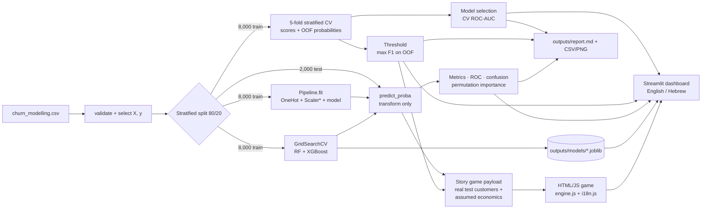

# Bank Customer Churn Prediction

**English** · [עברית](README_HE.md)

**Predicting which bank customers will leave, using five machine-learning models, rigorous cross-validation and hyperparameter tuning, explained through an interactive analytics dashboard and an immersive decision-story game.**


> **20.4% of the bank's 10,000 customers left.** This project ranks every customer by churn risk so that a retention team can act before revenue is lost. It compares an interpretable baseline with four tree ensembles, selects the winner on cross-validation (never on the test set), and explains every result in an interactive dashboard.

## ⭐ The crown jewel: *The Chief Retention Officer*

**An interactive machine learning decision story** (dashboard Section 9). You are the newly appointed Chief Retention Officer of a commercial bank. For five weeks you receive a $10,000 budget and five customers. Using the models' churn risk scores, you decide who gets a 📞 personal call, a 💳 fee waiver or a 👑 VIP package. Then you find out who really left.

- **It teaches by playing.** Four story chapters introduce *churn risk probability*, the *decision threshold* (CatBoost at the default 50% catches 50% of churners; at its cross-validated 28% it catches 70%) and the *Precision vs Recall* trade-off: wasted budget vs lost revenue.
- **Everything is clickable and instant.** It is built as a self-contained HTML/JS app inside Streamlit:
  - persona cards with live avatars and chat bubbles that react to every click and incentive;
  - glowing risk badges, and a threshold slider with *target all flagged*;
  - animated budget, savings and ROI tickers, and glassmorphism styling.
- **A model switcher inside the game.** Swap Logistic Regression, Random Forest, XGBoost, LightGBM and CatBoost live, and watch the risk scores, the flags and your expected ROI change. An *at-scale* panel shows what your rule means for all 2,000 test customers.
- **Debriefs that explain.** After each week you get a victory or defeat verdict, a success score and generated lessons such as *"Your threshold (50%) was too strict for Lukas: scored 30%, but left"*. It also compares every model's plan on the same customers, and shows how much model choice is worth at scale: a fee-waiver campaign nets **+$141,095 with XGBoost but −$93,923 with Logistic Regression**.
- **Real where it matters.** Every customer is a real held-out test customer with their real outcome; only the names, the stories and the money assumptions are invented. The game's engine (`engine.js`) is executed by the test suite under Node and checked against the Python reference engine.

[🎮 How to play ↓](#how-to-play-step-by-step) · [How it works ↓](#the-chief-retention-officer-interactive-decision-story)

---

## Table of contents

1. [Executive summary](#1-executive-summary)
2. [Quick start](#2-quick-start)
3. [Dashboard tour](#3-dashboard-tour) · [⭐ The Chief Retention Officer](#the-chief-retention-officer-interactive-decision-story) · [🎮 How to play](#how-to-play-step-by-step) · [🌐 English and Hebrew](#english-and-hebrew)
4. [Results](#4-results)
5. [Methodology and theory](#5-methodology-and-theory)
6. [Architecture](#6-architecture)
7. [Project structure](#7-project-structure)
8. [Testing and quality checks](#8-testing-and-quality-checks)
9. [Limitations](#9-limitations)
10. [Roadmap](#10-roadmap)

---

## 1. Executive summary

| Question | Answer |
|---|---|
| **The mission:** where are we diving? | Predict customer churn (`Exited = 1`) in a retail bank, so that churn becomes a risk that can be managed instead of a loss that can only be reported. |
| **The investigation:** what are we looking for? | Behavioural and demographic triggers. In the training data, customers with **3 products churn at 82%** (vs 7% with 2 products), **inactive members at 27%** (vs 14% active), **ages 50–59 at 56%** (vs 8% for ages 18–29) and customers in **Germany at 33%** (vs 16% in France). |
| **Success criteria:** how will we know? | Not accuracy: predicting "stays" for everyone is already ~80% accurate. Instead, use **ROC-AUC** (ranking quality), **5-fold stratified cross-validation** (mean ± std), and a **decision threshold chosen on training data** to trade Precision against Recall. |
| **Outcome** | Gradient boosting ranks customers best: **CatBoost and XGBoost reach 0.866 CV ROC-AUC**, LightGBM 0.863, Random Forest 0.849, and Logistic Regression 0.763. At the CV-optimised threshold, **CatBoost catches 70% of churners** on the untouched test set (vs 50% at the default 0.5 cut-off). |

These churn rates are **associations in this dataset, not proven causes**.

---

## 2. Quick start

```bash
git clone <your-repository-url>
cd churn_modelling
python -m venv .venv
# Windows: .venv\Scripts\activate    macOS/Linux: source .venv/bin/activate
pip install -r requirements.txt

python main.py                 # full workflow -> outputs/ (~8-10 min, mostly GridSearchCV)
python -m pytest               # 106 automated tests (~8 min including the dashboard tests)
streamlit run app.py --server.address=localhost --server.port=8501
```

Then open **http://localhost:8501/**. The same address and port are set in `.streamlit/config.toml`, so a plain `streamlit run app.py` (run from the project folder) behaves the same way.

- The first page load takes about a minute while five models are cross-validated and trained; results are then cached.
- The tuning page (Section 4) loads the tuned models saved by `main.py`. **Run `main.py` once before opening it.** The `outputs/` folder (report, tables, charts, tuned models) is not stored in the repository: it is fully regenerated by `main.py`.
- On its very first run Streamlit may ask for an e-mail address in the terminal; press Enter to skip.

`main.py` stops with a clear error, and writes nothing, if the dataset is missing, a required column is absent, the target is not strictly 0/1, or features contain missing values.

---

## 3. Dashboard tour

A Streamlit dashboard (`app.py`) with ten sections, in **English (default) or Hebrew**. **Every metric column, control and KPI has a hover tooltip**, every section has a *Key terms* panel, and the sidebar holds a full glossary (`churn/glossary.py`).

**Mobile-friendly.** The dashboard and the story game adapt to phones, tablets and desktops:
- the sidebar collapses automatically on small screens;
- custom panels use CSS media queries;
- the game's board reflows from 3 card columns to 2 to 1;
- the game's iframe grows to fit its content, so there is no scroll-in-scroll on touch screens.

Every section was audited in headless Chrome at 360, 390, 768, 1024 and 1440 px, with no horizontal overflow.

| # | Section | What you will find |
|---|---|---|
| 0 | **Executive Briefing & Journey Map** | The mission, the investigation and the success criteria; live headline KPIs; measured churn triggers; an interactive six-stage journey map (Data Inspection → Preprocessing → Base Models → Advanced Boosters → Tuning → Final Deployment) that links to the evidence. |
| 1 | Project Overview & Data Inspection | Business objective, feature dictionary, live data-health checks, class balance, and churn by segment with sample sizes. |
| 2 | Preprocessing & Pipeline Architecture | Pipeline diagram, stratified split, one-hot encoding, standardisation, and a live proof that preprocessing learns from training rows only. |
| 3 | Model Explorer & Comparison | Metrics, confusion matrices, ROC and Precision–Recall curves with operating points, threshold strategies, and a generated "which model is best and why" analysis. |
| 4 | Hyperparameter Tuning: Before vs After | KPI deltas, before/after charts for CV and test, fold-by-fold comparison, every grid candidate ranked, all seven candidates compared, and an analysis of the Precision / Recall / ROC-AUC trade-offs. |
| 5 | Cross-Validation & Robustness | Fold construction, mean ± std for five metrics, box plots, paired fold comparisons, and a train vs CV vs test generalisation check. |
| 6 | Feature Importance | Built-in importance (four tree models) and permutation importance (all five models), with automated insights. |
| 7 | Interactive Churn Prediction Tool | Enter a customer profile; get each model's probability, a gauge against the threshold, a what-if driver chart and a business interpretation. |
| 8 | Methodology & Future Roadmap | Metric formulas, class weighting and threshold maths, a threshold explorer, a cost-sensitive simulator, an **animation of gradient boosting**, documented hyperparameters with explanations, and the roadmap. |
| 9 | **⭐ The Chief Retention Officer: A Machine Learning Decision Story** | The interactive story game: five weeks, five real customers a week, a live model switcher and threshold, instant chat-bubble reactions, real outcomes and an educational debrief. [Details below](#the-chief-retention-officer-interactive-decision-story). |

**Sidebar controls**

- **Class balancing:** *None* or *Balanced*, which up-weights churners in training (`class_weight="balanced"` for Logistic Regression, Random Forest and LightGBM; `scale_pos_weight = #stayed / #churned` for XGBoost; `auto_class_weights="Balanced"` for CatBoost). All weights come from the training labels only.
- **Threshold strategy:**
  - *Default (0.5 cutoff)*: the models' own `predict()`, identical to `main.py`.
  - *CV-optimized (max F1)*: a per-model threshold maximising F1 on out-of-fold training predictions. The test set is never used to choose it.
  - *Custom (slider)*: any value from 0.10 to 0.90. This is exploratory, and the dashboard warns that picking a threshold by watching test metrics is test-set tuning.

### The Chief Retention Officer (interactive decision story)

| Stage | What happens |
|---|---|
| **Story** | Four chapters with this project's own numbers: your mission and budget, churn risk probability and each model's ROC-AUC, the decision threshold (50% vs the cross-validated optimum, with real Recall and Precision on 2,000 test customers), and the four outcomes (true and false positives and negatives). |
| **Weekly board** | Five persona cards: 👨‍💼 *David, the High-Value Business Owner*, 👩‍🎓 *Sarah, the Disengaged Student*, 👴 *Michael, the Senior Investor*, 👩‍👧 *Emma, the Established Family Customer* and 🧔 *Lukas, the Over-Banked Customer*. Each shows a live avatar, a chat bubble, a glowing risk badge (😠 high risk at or above the threshold, 😐 wavering above the base rate, 😊 loyal), a risk bar with the threshold marker, a profile and the value at stake. Clicking a card makes the customer talk. Each card has four action buttons (🚫 none, 📞 $500 / 25% success, 💳 $1,500 / 40%, 👑 $3,500 / 60%), and the bubble reacts to each choice. Over-budget choices shake the card. |
| **Live HUD** | Budget left with a progress bar, money committed, model-expected savings and expected ROI, and the season total, all animated tickers. |
| **Model switcher** | Five chips with each model's CV ROC-AUC and optimal threshold. Switching re-scores every card instantly. |
| **Threshold** | A slider, *use the model's optimum*, *default 50%*, and **🎯 target all flagged** with an incentive of your choice (highest risk first when the budget is short). |
| **At-scale panel** | For the current model, threshold and incentive: flagged customers, Recall, Precision, wasted budget, missed churners and net value on all 2,000 test customers, computed from real confusion counts. |
| **Reveal** | Cards flip one by one with the real outcome (✅ reached a churner, ❌ missed churner, ⚠️ wasted on a loyal customer, 👍 correctly left alone), and the chat bubbles tell their side of the story. The tickers switch to real savings and ROI. |
| **Debrief** | A victory or defeat verdict with a badge and an animated 0–100 success score (your net value as a share of perfect hindsight), plus true savings, wasted budget, lost revenue and net ROI. You are compared with your model's own plan and with perfect hindsight; a chart shows every model's plan scored on the real outcomes. Generated lessons cover the threshold (who slipped below it), Precision (loyal customers flagged), your false positives and negatives, model choice this week, and model choice at scale. |
| **Season report** | After five weeks: your total vs following the models vs perfect hindsight, wasted vs lost, and five takeaways for a Chief Retention Officer. |

### How to play: step by step

> Open the dashboard, then pick **"9. The Chief Retention Officer"** in the sidebar. On a phone, open the sidebar with the **»** icon at the top left.

1. **Read the story (about 2 minutes).** Four short chapters explain your job, what a churn probability is, why the threshold matters (50% vs the model's cross-validated optimum) and the Precision/Recall trade-off. Use **Next →**, or **Skip story** if you already know the basics. **📖 Story** brings it back at any time.
2. **Meet the week's five customers.** Each card shows the customer's churn risk from the selected model, a risk bar with the threshold marker, a mood badge (😠 high risk, 😐 wavering, 😊 loyal), a short profile and the **value at stake** if they leave. **Click a card** and the customer talks to you in the chat bubble.
3. **Choose your crystal ball.** The model chips (Logistic Regression, Random Forest, XGBoost, LightGBM, CatBoost) show each model's ROC-AUC and optimal threshold; ⭐ marks the model selected by cross-validation. Switching models re-scores every card instantly. Try the same customers under Logistic Regression and CatBoost.
4. **Set your rule.** Move the **decision threshold** slider: customers at or above it are flagged and glow red. *Use model's optimum* and *Default 50%* jump to the two reference points. Watch the **🔭 at-scale panel**: it shows what your rule would do on all 2,000 test customers (flagged, Recall, Precision, wasted budget, missed churners, net value).
5. **Spend the budget.** Give each customer an incentive with the buttons under the card: 🚫 none, 📞 call ($500, 25% success), 💳 fee waiver ($1,500, 40%) or 👑 VIP ($3,500, 60%). The customer reacts in the bubble, and the HUD updates the budget left, the model-expected savings and the expected ROI. Or choose an incentive and press **🎯 Target all flagged** to apply your threshold rule (highest risk first if money runs out). You cannot overspend the $10,000: the card shakes.
6. **Reveal what happened.** Press **🎲 Reveal what happened**. Cards flip one by one with the **real outcome**: ✅ you reached a churner (expected saving), ❌ a churner left unreached (lost value), ⚠️ you paid a customer who was staying anyway (wasted), 👍 a loyal customer correctly left alone.
7. **Learn from the debrief.** It shows:
   - a victory or defeat verdict with a badge and a **0–100 success score** (your net value as a share of what perfect hindsight would have earned);
   - the four KPIs: true savings, wasted budget, lost revenue and net ROI;
   - you vs your model's own plan vs perfect hindsight, plus every model's plan scored on the same real customers;
   - generated lessons, for example a threshold that was too strict, loyal customers flagged, or a better model choice.
8. **Play five weeks.** **Next week →** deals five new real customers. After week 5, the **season report** totals your results against following the models and against perfect hindsight, with five takeaways. **🔁 Play again** restarts the season.

**Tips from the data**
- With about one churner in five, **a 50% threshold misses many leavers**. Start from the model's optimum (around 28–34%).
- Expensive incentives pay off only on customers who are likely to leave. A VIP package for a 10%-risk customer is usually wasted.
- One week of five customers is noisy: a weaker model can win a single week. The at-scale panel and the season total show which choices hold up.

**What is real and what is assumed.**
- **Real:** every persona is a real customer from the held-out test set, drawn at random from an archetype with a fixed seed per week (never chosen by score or outcome). Each customer's five model probabilities and their real outcome come from the test set, as do the confusion counts behind the at-scale panel.
- **Invented:** the names, avatars, stories and dialogue.
- **Assumed:** customer value (base + per product + share of balance), incentive costs and success rates are game assumptions (`churn/game.py::Economics`). Money results are expected values in game dollars.

**How it is built.**
- **Data:** `churn/story_game.py` builds a JSON payload from the analysis (customers, five models' probabilities, CV thresholds, and confusion counts at every threshold).
- **Page:** it injects the payload into `churn/game_assets/game.html`, which has no external requests.
- **Embedding:** the dashboard embeds the page with `st.iframe(..., height="content")`, the current replacement for the deprecated `st.components.v1.html`. The iframe sizes itself to the game. The page is responsive (breakpoints at 1180, 860, 560 and 480 px), and its debrief opens inline so it works at any height. The cached page is keyed on a hash of the game files, so edits always show up.
- **Money logic:** all money and scoring logic lives in `churn/game_assets/engine.js` as pure functions. `tests/test_story_game.py` runs it under Node and compares outcomes, plans, scores, badges and at-scale statistics with the Python reference engine and with direct test-set computations.

### English and Hebrew

The language selector at the top of the sidebar (**🌐 Language · שפה**) switches the interface between **English (default)** and **Hebrew**:

- **Fully translated:**
  - navigation, page titles and subtitles, and sidebar controls;
  - the **Executive Briefing**: hero, mission cards, KPIs, churn triggers and journey map;
  - every **metric tooltip**, the *Key terms* panels and the sidebar **glossary**;
  - **the entire story game**: story, personas and dialogue, lessons, debrief and season report.
- **In English on the other pages:** the deeper analytical prose and the automatically generated insights. Hebrew mode says so with a short note.
- **Right-to-left layout:** Hebrew turns on RTL layout for the dashboard and the game. Charts, tables, code, sliders and numbers stay left-to-right, and the journey map runs right to left. Hebrew text uses the Assistant font.
- **Navigation:** switching language keeps you on the same section.
- **Gender-neutral wording:** Hebrew text addresses the reader in the plural ("אתם"). Each persona speaks in their own grammatical gender.
- **Where the text lives:** dashboard strings in `churn/i18n.py`, definitions in `churn/glossary.py`, and game text in `churn/game_assets/i18n.js`. Tests check that both languages define the same keys and the same placeholders.

The Hebrew documentation is in [README_HE.md](README_HE.md).

### Screenshots

> **📸 Screenshot guide.** Screenshots are not committed yet. To add them, run the dashboard, capture each view below at a browser width of about 1440 px, save it in `docs/screenshots/` under the file name given, and remove the `<!--` `-->` around the matching image line. See [`docs/screenshots/README.md`](docs/screenshots/README.md) for details.

| View | File name | What to capture |
|---|---|---|
| Executive briefing | `01-executive-briefing.png` | Section 0, top of the page: hero banner and the three mission cards. |
| Journey map | `02-journey-map.png` | Section 0, the churn-trigger cards and the journey map with a stage selected. |
| Model comparison | `03-model-comparison.png` | Section 3, *ROC curves* tab. |
| Tuning before vs after | `04-tuning-before-after.png` | Section 4, KPI row and the *Before vs after* chart. |
| Cross-validation | `05-cross-validation.png` | Section 5, the box plot of fold scores. |
| Prediction tool | `06-prediction-tool.png` | Section 7, a high-risk profile showing the gauge and the driver chart. |
| Story game: board | `07-story-game-board.png` | Section 9, a week in progress: persona cards with chat bubbles, the model switcher and the HUD. |
| Story game: debrief | `08-story-game-debrief.png` | Section 9 after *Reveal*: the debrief with score ring, KPIs and lessons. |

<!--  -->
<!--  -->
<!--  -->
<!--  -->
<!--  -->
<!--  -->
<!--  -->
<!--  -->

The animation below is committed and renders directly on GitHub. Result tables and charts are generated into `outputs/` by `python main.py`.

<p align="center"></p>

*Gradient boosting on a small synthetic churn-vs-age problem. Each round fits a depth-2 tree to the current residuals (left and middle panels). Training loss keeps falling, but the loss on unseen data levels off after about 15 trees: extra trees then fit noise (right panel).*

---

## 4. Results

All numbers below were produced by `python main.py` (random seed 42); running it reproduces them in `outputs/report.md`. The test set has 2,000 customers (407 churners) that were never used for fitting or selection.

### 4.1 Cross-validation on the training set (5 folds, mean ± std, threshold 0.5)

| Model | Accuracy | Precision | Recall | F1 | ROC-AUC |
|---|---|---|---|---|---|
| Logistic Regression | 0.810 ± 0.007 | 0.597 ± 0.050 | 0.214 ± 0.029 | 0.315 ± 0.037 | 0.763 ± 0.022 |
| Random Forest | 0.857 ± 0.012 | 0.746 ± 0.042 | 0.452 ± 0.039 | 0.562 ± 0.042 | 0.849 ± 0.015 |
| XGBoost | 0.863 ± 0.010 | 0.754 ± 0.029 | 0.486 ± 0.037 | 0.591 ± 0.036 | 0.866 ± 0.012 |
| LightGBM | 0.861 ± 0.010 | 0.742 ± 0.026 | 0.487 ± 0.042 | 0.587 ± 0.039 | 0.863 ± 0.013 |
| **CatBoost** | 0.863 ± 0.010 | 0.757 ± 0.034 | 0.484 ± 0.035 | 0.590 ± 0.036 | **0.866 ± 0.012** |

### 4.2 Untouched test set (threshold 0.5)

| Model | Precision | Recall | F1 | Accuracy | ROC-AUC |
|---|---|---|---|---|---|
| Logistic Regression | 0.589 | 0.187 | 0.284 | 0.808 | 0.775 |
| Random Forest | 0.753 | 0.442 | 0.557 | 0.857 | 0.849 |
| XGBoost | 0.776 | 0.484 | 0.596 | 0.866 | 0.867 |
| LightGBM | 0.771 | 0.504 | 0.609 | 0.868 | 0.864 |
| **CatBoost** | **0.815** | 0.499 | **0.619** | **0.875** | **0.868** |

### 4.3 Thresholds chosen on cross-validation (test set)

At the default 0.5 cut-off every model misses about half of the churners. Each model's threshold is therefore chosen to maximise F1 on **out-of-fold training predictions**; the test set below is only scored.

| Model | Threshold | Precision | Recall | F1 |
|---|---|---|---|---|
| Logistic Regression | 0.260 | 0.443 | 0.590 | 0.506 |
| Random Forest | 0.310 | 0.564 | 0.651 | 0.604 |
| XGBoost | 0.342 | 0.641 | 0.614 | 0.627 |
| LightGBM | 0.285 | 0.575 | 0.671 | 0.619 |
| **CatBoost** | 0.278 | 0.584 | **0.698** | **0.636** |

### 4.4 Hyperparameter tuning (GridSearchCV, before vs after)

| Model | Changed settings | CV ROC-AUC | Test ROC-AUC |
|---|---|---|---|
| Random Forest | `n_estimators` 200 → 400, `max_depth` None → 12, `min_samples_leaf` 1 → 4 | 0.849 → **0.857** (better in 5/5 folds) | 0.849 → **0.860** |
| XGBoost | `learning_rate` 0.05 → 0.03, `max_depth` 4 → 5 | 0.866 → 0.866 | 0.867 → 0.866 |

Tuning helped Random Forest: limiting tree depth and requiring at least 4 customers per leaf reduced overfitting, and test Precision rose from 0.753 to 0.817. XGBoost's documented baseline was already near-optimal for this grid.

### 4.5 Which model is best, and why

- **Selection, on cross-validation only:** CatBoost has the highest mean CV ROC-AUC of the untuned models, and the test set confirms it (0.868). XGBoost, tuned XGBoost and CatBoost are within 0.001 CV ROC-AUC of each other, which is far less than the fold-to-fold standard deviation (≈ 0.012). **The top boosters are practically tied.** Tuned XGBoost's CV score is slightly optimistic, because its settings were chosen on those same folds.
- **Why trees beat the linear model (measured):** churn is strongly **non-monotonic** in `NumOfProducts` (7% at 2 products, 82% at 3) and in `Age` (it peaks at 50–59). Logistic Regression fits one slope per feature and gains almost nothing from `NumOfProducts` (permutation importance ≈ 0.000), whereas every tree model relies on it heavily (≈ 0.116).
- **Why boosting edges out bagging (explanation):** Random Forest averages deep, independent trees, which mainly reduces variance. Boosting adds shallow trees sequentially, each correcting the ensemble's remaining errors, with shrinkage and regularisation. On structured tabular data this usually ranks risk better.
- **Trade-offs at threshold 0.5:** LightGBM catches the most churners (Recall 0.504), tuned Random Forest raises the fewest false alarms (Precision 0.817), and CatBoost has the best balance (F1 0.619). Precision and Recall move with the threshold; ROC-AUC does not. Selection therefore uses ROC-AUC, and the threshold is chosen separately.

**Most important features** (permutation importance: the drop in test ROC-AUC when the feature is shuffled, averaged over the tree models): `Age` ≈ 0.12, `NumOfProducts` ≈ 0.12, `Balance` ≈ 0.04, `IsActiveMember` ≈ 0.03 and `Geography` ≈ 0.03. `CreditScore`, `Tenure`, `HasCrCard` and `EstimatedSalary` contribute ≈ 0.

---

## 5. Methodology and theory

### 5.1 Data

`churn_modelling.csv`: 10,000 customers × 13 columns, no missing values or duplicate rows. The positive class (`Exited = 1`, the customer left) makes up 20.37% of rows.

| Role | Columns |
|---|---|
| Numeric features (8) | `CreditScore`, `Age`, `Tenure`, `Balance`, `NumOfProducts`, `HasCrCard`, `IsActiveMember`, `EstimatedSalary` |
| Categorical features (2) | `Geography`, `Gender` (one-hot encoded) |
| Excluded identifiers | `CustomerId`, `Surname`: they carry no general signal, would allow memorisation, and `Surname` is a fairness risk |
| Target | `Exited` |

### 5.2 Leakage-free pipeline

1. **Split first:** one stratified 80/20 split (`random_state=42`), shared by every model. Train and test both keep the 20.4% churn rate.
2. **Preprocessing inside the `Pipeline`:** `OneHotEncoder(handle_unknown="ignore")` for categories, plus `StandardScaler` for Logistic Regression only (tree splits do not depend on scale). `fit()` learns categories, means and standard deviations from training rows only.
3. **Dense output** (`sparse_threshold=0`): XGBoost treats entries missing from a sparse matrix as *missing values*, which would corrupt one-hot zeros and `Balance = 0`.
4. **Cross-validation refits the whole pipeline in every fold**, so a held-out fold never influences the preprocessing it is scored with.

### 5.3 Metrics

All metrics treat `Exited = 1` as the positive class (TP = churner correctly flagged, FP = loyal customer flagged, FN = churner missed).

| Metric | Formula | Question it answers |
|---|---|---|
| Precision | TP / (TP + FP) | Of the customers we flag, how many really churn? (Wasted retention budget.) |
| Recall | TP / (TP + FN) | Of the customers who churn, how many do we catch? (Lost customers.) |
| F1 | 2 · P · R / (P + R) | Are Precision and Recall *both* good? |
| Accuracy | (TP + TN) / all | Supplementary only: predicting "stays" for everyone already scores ~0.80. |
| ROC-AUC | area under TPR vs FPR | The probability that a random churner is scored above a random non-churner (0.5 = coin flip, 1.0 = perfect). Threshold-free. |

### 5.4 Models

| Model | Family | Key idea | Baseline settings |
|---|---|---|---|
| Logistic Regression | Linear | One slope per feature on the log-odds scale; interpretable but cannot represent U-shapes or interactions without feature engineering. | `max_iter=1000`, L2, `C=1.0`, scaled inputs |
| Random Forest | Bagging | Averages many deep trees, each trained on a bootstrap sample with random feature subsets; reduces variance. | `n_estimators=200` |
| XGBoost | Gradient boosting | Adds shallow trees one at a time, each fitted to the gradient of the loss; regularised (shrinkage, subsampling, L2). | `n_estimators=300`, `learning_rate=0.05`, `max_depth=4`, `subsample=0.8`, `colsample_bytree=0.8` |
| LightGBM | Gradient boosting | Histogram-based splits and **leaf-wise** growth (expands the leaf with the largest loss reduction). | `n_estimators=300`, `learning_rate=0.05`, `num_leaves=15`, `subsample=0.8`, `colsample_bytree=0.8` |
| CatBoost | Gradient boosting | **Symmetric (oblivious) trees**, one split per level, plus ordered boosting to reduce overfitting. | `iterations=300`, `learning_rate=0.05`, `depth=6`, `l2_leaf_reg=3` |

All models use a fixed seed of 42. CatBoost receives the same one-hot-encoded input as the others; its native categorical handling is not used, so that the comparison is like for like.

### 5.5 Cross-validation

`StratifiedKFold(n_splits=5, shuffle=True, random_state=42)` on the 8,000 training customers. Each fold is held out once while a fresh pipeline is trained on the other four. This yields:

- **mean ± std** per metric: a more reliable estimate than one split, with its uncertainty;
- **paired fold comparisons**: all models use identical folds, so "model A beats model B in 5/5 folds" is a fair statement;
- **out-of-fold probabilities** for every training customer, which are used to choose decision thresholds without touching the test set.

### 5.6 Hyperparameter tuning

`GridSearchCV` (`churn/tuning.py`) is scored by ROC-AUC on the **same five training folds** as the baseline CV, so baseline and tuned fold scores are paired.

| Model | Grid (baseline values included) | Candidates |
|---|---|---|
| Random Forest | `n_estimators` {200, 400} × `max_depth` {None, 8, 12} × `min_samples_leaf` {1, 4} | 12 |
| XGBoost | `n_estimators` {300, 600} × `learning_rate` {0.03, 0.05, 0.1} × `max_depth` {3, 4, 5} | 18 |

The best candidate is refitted on the full training set, saved with `joblib` to `outputs/models/`, and evaluated once on the test set. Because the winner is picked on the CV folds, **its CV score carries a small selection bias**; the test set is the fair before-vs-after comparison. Nested CV would remove the bias (see the roadmap).

### 5.7 Class imbalance: two levers

- **Class weighting** (changes training): weight per class w_c = n / (k · n_c). Each churner's error counts about 3.9× as much as a loyal customer's.
- **Threshold selection** (changes decisions): flag a customer when P(churn) ≥ t, with *t* chosen to maximise F1 on out-of-fold predictions. A cost-sensitive variant (cost of a missed churner vs cost of a false alarm) is available as a what-if in the dashboard.

### 5.8 Feature importance

- **Built-in** (tree models): Random Forest = impurity decrease, XGBoost and LightGBM = gain, CatBoost = prediction change. These are computed on training data and favour continuous features with many split points.
- **Permutation** (all models): the drop in test ROC-AUC when one raw feature is shuffled (10 repeats). One-hot columns are measured as whole features.

### 5.9 Number formatting

Every displayed metric goes through one rounding rule (`churn/formatting.py`, round half to even), so the CLI, the CSV files, the report and the dashboard always show the same digits.

---

## 6. Architecture



\*The scaler is used in the Logistic Regression pipeline only.

**Design principles**

- **One model registry** (`churn/models.py::build_models`): add a pipeline there and cross-validation, evaluation, importance, the report and the dashboard pick it up.
- **Generated, never hand-typed, conclusions:** `churn/insights.py` and `churn/tuning.py` turn measured numbers into sentences labelled *measured* or *explanation*. If the data changes, the text changes with it.
- **One computation path:** the dashboard (`churn/analysis.py`) uses the same split, pipelines and functions as `main.py`, and a test checks that both report the same numbers.
- **Games stay honest:** the story game plays with real test customers and real outcomes. Its browser engine (`engine.js`) is pure functions, tested under Node against the Python reference engine (`churn/game.py`), and every money assumption lives in one `Economics` object.

---

## 7. Project structure

```
churn_modelling/
├── main.py                      # single entry point: the 11-step workflow
├── app.py                       # Streamlit dashboard (10 sections, incl. the story game)
├── churn_modelling.csv          # dataset (never modified by the code)
├── requirements.txt
├── pytest.ini
├── .streamlit/config.toml       # dashboard served at localhost:8501
├── assets/gradient_boosting.gif # animation shown in the dashboard and in this README
├── docs/screenshots/            # dashboard screenshots (see the guide inside)
├── README_HE.md                 # this documentation in Hebrew
├── churn/
│   ├── config.py                # paths, column lists, split and CV settings, random seed
│   ├── data.py                  # load, validate, define X/y, train/test split
│   ├── preprocessing.py         # ColumnTransformer: one-hot + optional scaling (dense output)
│   ├── models.py                # model registry: LR, RF, XGBoost, LightGBM, CatBoost; class weighting
│   ├── validation.py            # stratified k-fold CV: fold scores + out-of-fold probabilities
│   ├── tuning.py                # GridSearchCV, before-vs-after comparison, save/load tuned models
│   ├── thresholds.py            # F1 / cost threshold selection from out-of-fold probabilities
│   ├── importance.py            # built-in and permutation feature importance
│   ├── insights.py              # CV-based model selection and evidence-based summaries
│   ├── evaluation.py            # metrics, comparison tables and plots
│   ├── explain.py               # per-customer what-if explanation
│   ├── analysis.py              # everything the dashboard computes
│   ├── glossary.py              # definitions behind every tooltip (English and Hebrew)
│   ├── i18n.py                  # dashboard interface text in English and Hebrew
│   ├── animation.py             # renders the gradient-boosting GIF
│   ├── game.py                  # story game: personas, game economics, Python reference engine
│   ├── story_game.py            # story game: real-data payload + HTML rendering
│   ├── game_assets/
│   │   ├── game.html            # the interactive game (HTML/CSS/JS, self-contained)
│   │   ├── engine.js            # pure game logic, tested under Node
│   │   └── i18n.js              # game text in English and Hebrew
│   ├── formatting.py            # the single rounding rule
│   └── report.py                # writes outputs/report.md
├── tests/                       # pytest suite (components, workflow, dashboard)
└── outputs/                     # created by main.py (not committed; regenerate with python main.py)
    ├── report.md                # full results report
    ├── model_comparison.csv · cv_results.csv · cv_folds.csv · feature_importance.csv
    ├── tuning_comparison.csv · tuning_best_params.csv · tuning_cv_folds.csv · tuning_grid_results.csv
    ├── roc_curves.png · confusion_matrices.png · feature_importance.png · tuning_before_after.png
    └── models/                  # tuned pipelines (joblib)
```

---

## 8. Testing and quality checks

```bash
python -m pytest
```

The suite (106 tests) covers:

- **Data:** validation errors for missing files or columns, a non-binary target and missing values; stratification; the absence of identifiers and the target from `X`.
- **Leakage:** scalers learn training statistics only; CV never fits the pipeline passed in.
- **Models:** documented settings, class weighting reaching every model, dense preprocessing output, valid probabilities.
- **Cross-validation and tuning:** fold scores, out-of-fold coverage, grids containing the baselines, baseline candidates reproducing the baseline CV exactly, and save/load round trips of the tuned models.
- **Workflow:** `main.py` end to end on a synthetic dataset, including every output file and the report sections.
- **Story game:**
  - Money outcomes follow the confusion matrix, the perfect plan beats every alternative within budget, and personas match their archetypes and are reproducible.
  - The payload's customers, probabilities, outcomes, thresholds and confusion counts equal the real test-set values, and the rendered page is self-contained.
  - Every script parses (`node --check`), and **the JavaScript engine reproduces the Python engine** on 25 random weeks and the real at-scale counts.
- **Dashboard:** headless Streamlit `AppTest` renders all ten sections under every threshold strategy and both class weightings, checks the tooltips and the journey-map navigation, checks that the story game is embedded with this configuration's real data, and checks that the tuning page's numbers equal those saved by `main.py`.
- **English and Hebrew:**
  - Every interface string, glossary entry, hyperparameter explanation, persona line and game text exists in both languages with the same placeholders.
  - Hebrew text really is Hebrew, and every game text function renders in both languages under Node.
  - In the dashboard, switching to Hebrew keeps the current section, every section renders with its Hebrew title, and the game is embedded in Hebrew.
- **Formatting, glossary and animation:** a single rounding rule, every metric and hyperparameter explained, and the animation's loss behaviour.

Reproducibility: with seed 42, repeated runs of `main.py` produce byte-identical CSV files.

---

## 9. Limitations

- One static dataset of undocumented origin and period; patterns may not transfer to other banks or periods.
- Only Random Forest and XGBoost are tuned, over small grids; the other models use documented baselines. Tuned CV scores carry a small selection bias.
- The test metrics come from one split. CV standard deviations show the variability, but there are no confidence intervals on the test metrics.
- The F1-optimal threshold weights Precision and Recall equally; real retention costs are unknown.
- Probabilities are not calibrated.
- Importances and churn rates are associations, not causal effects.
- This is an **educational project**, not validated for real banking decisions.

---

## 10. Roadmap

| Enhancement | Status |
|---|---|
| XGBoost, LightGBM and CatBoost | ✅ Implemented |
| Stratified k-fold cross-validation | ✅ Implemented |
| Feature importance (built-in + permutation) | ✅ Implemented |
| Class weighting and CV-based threshold optimisation | ✅ Implemented |
| GridSearchCV tuning (Random Forest, XGBoost) | ✅ Implemented |
| Executive briefing, journey map, tooltips, boosting animation | ✅ Implemented |
| The Chief Retention Officer: interactive ML decision story (HTML/JS) | ✅ Implemented |
| English / Hebrew interface with right-to-left layout | ✅ Implemented |
| Nested cross-validation for tuning | 🗓️ Planned |
| Tuning LightGBM and CatBoost | 🗓️ Planned |
| Probability calibration (`CalibratedClassifierCV`) | 🗓️ Planned |
| SHAP explanations | 🗓️ Planned |
| Bootstrap confidence intervals on test metrics | 🗓️ Planned |
