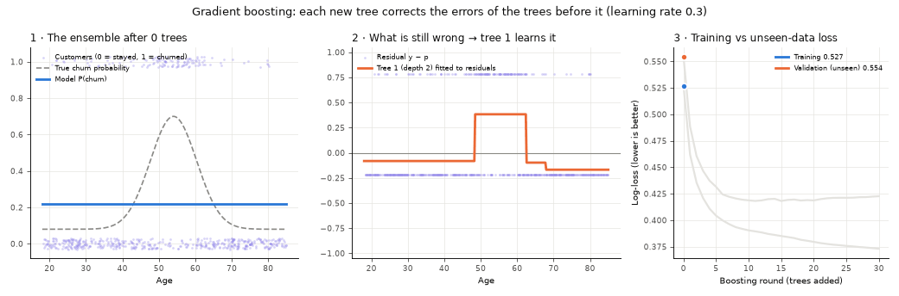
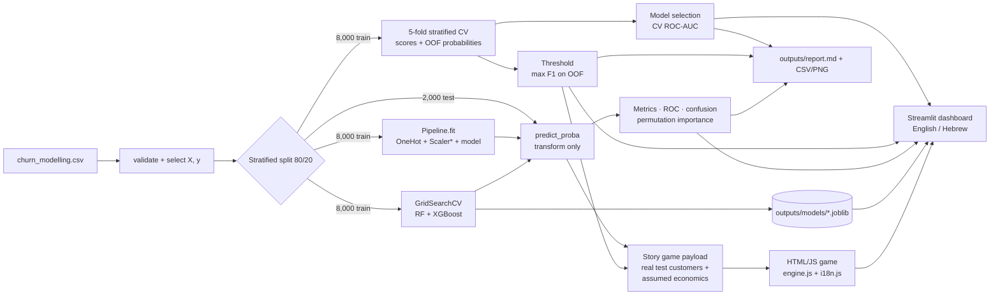

# חיזוי נטישת לקוחות בנק

[](https://churn-prediction-game.streamlit.app/)

### 🚀 [לאפליקציה החיה: churn-prediction-game.streamlit.app](https://churn-prediction-game.streamlit.app/)

לוח הבקרה האינטראקטיבי ומשחק *מנהלי השימור*, באנגלית ובעברית, בלי שום התקנה. לעברית בוחרים **עברית** בראש סרגל הצד.

[English](README.md) · **עברית**

**חיזוי אילו לקוחות בנק עומדים לעזוב בעזרת חמישה מודלים של למידת מכונה, אימות צולב קפדני וכוונון היפר-פרמטרים. התוצאות מוסברות בלוח בקרה אינטראקטיבי ובמשחק החלטות סיפורי.**


> **20.4% מ-10,000 לקוחות הבנק עזבו.** הפרויקט מדרג כל לקוח לפי סיכון הנטישה שלו, כדי שצוות השימור יוכל לפעול לפני שההכנסות אובדות. הוא משווה מודל בסיס פרשני לארבעה אנסמבלים של עצים, בוחר את המנצח לפי אימות צולב (לעולם לא לפי קבוצת הבדיקה), ומסביר כל תוצאה בלוח בקרה אינטראקטיבי.

## ⭐ גולת הכותרת: *מנהלי השימור* (The Chief Retention Officer)

**סיפור החלטות אינטראקטיבי בלמידת מכונה** (פרק 9 בלוח הבקרה). אתם ראשי מחלקת השימור החדשים בבנק מסחרי. במשך חמישה שבועות מקבלים תקציב של ‎$10,000 וחמישה לקוחות. בעזרת ציוני סיכון הנטישה של המודלים מחליטים מי יקבל 📞 שיחה אישית, 💳 ויתור על עמלות או 👑 חבילת VIP. ואז מגלים מי באמת עזב.

- **לומדים תוך כדי משחק.** ארבעה פרקי סיפור מציגים את *הסתברות סיכון הנטישה*, את *סף ההחלטה* (CatBoost בסף ברירת המחדל 50% תופס 50% מהנוטשים; בסף שנקבע באימות צולב, 28%, הוא תופס 70%) ואת האיזון בין *Precision ל-Recall*: תקציב מבוזבז מול הכנסות שאבדו.
- **הכול לחיץ ומגיב מיד.** המשחק בנוי כאפליקציית HTML/JS עצמאית בתוך Streamlit:
  - כרטיסי לקוחות עם אווטארים ובועות דיבור שמגיבות לכל לחיצה ולכל תמריץ;
  - תגי סיכון זוהרים, ומחוון סף עם כפתור *פנו לכל המסומנים*;
  - מוני תקציב, חיסכון ו-ROI מונפשים, בעיצוב glassmorphism.
- **מחליף מודלים בתוך המשחק.** מחליפים בזמן אמת בין Logistic Regression, Random Forest, XGBoost, LightGBM ו-CatBoost, וצופים בציוני הסיכון, בסימונים וב-ROI הצפוי משתנים. לוח *בקנה מידה* מראה מה המשמעות של הכלל שלכם על כל 2,000 לקוחות הבדיקה.
- **תחקירים שמסבירים.** בסוף כל שבוע מתקבלים פסק דין של ניצחון או הפסד, ציון הצלחה ולקחים שנוצרים אוטומטית, למשל *"הסף שלכם (50%) היה מחמיר מדי עבור לוקאס: הציון היה 30%, והנטישה קרתה"*. התחקיר משווה גם את התוכנית של כל מודל על אותם לקוחות, ומראה כמה בחירת המודל שווה בקנה מידה: קמפיין ויתור על עמלות מניב **‎+$141,095 עם XGBoost אבל ‎−$93,923 עם Logistic Regression**.
- **אמיתי במה שחשוב.** כל לקוח הוא לקוח בדיקה אמיתי שהוחזק בצד, עם התוצאה האמיתית שלו. רק השמות, הסיפורים והנחות הכסף בדויים. מנוע המשחק (`engine.js`) מורץ בחבילת הבדיקות תחת Node ומושווה למנוע הייחוס בפייתון.

[🎮 איך משחקים ↓](#איך-משחקים-צעד-אחר-צעד) · [איך זה עובד ↓](#מנהלי-השימור-סיפור-החלטות-אינטראקטיבי)

---

## תוכן עניינים

1. [תקציר מנהלים](#1-תקציר-מנהלים)
2. [התחלה מהירה](#2-התחלה-מהירה)
3. [סיור בלוח הבקרה](#3-סיור-בלוח-הבקרה) · [⭐ מנהלי השימור](#מנהלי-השימור-סיפור-החלטות-אינטראקטיבי) · [🎮 איך משחקים](#איך-משחקים-צעד-אחר-צעד) · [🏆 איך מצליחים](#איך-מצליחים-האסטרטגיה-המנצחת) · [🌐 אנגלית ועברית](#אנגלית-ועברית)
4. [תוצאות](#4-תוצאות)
5. [מתודולוגיה ותיאוריה](#5-מתודולוגיה-ותיאוריה)
6. [ארכיטקטורה](#6-ארכיטקטורה)
7. [מבנה הפרויקט](#7-מבנה-הפרויקט)
8. [בדיקות ובקרת איכות](#8-בדיקות-ובקרת-איכות)
9. [מגבלות](#9-מגבלות)
10. [מפת דרכים](#10-מפת-דרכים)

---

## 1. תקציר מנהלים

| שאלה | תשובה |
|---|---|
| **המשימה:** לאן אנחנו צוללים? | לחזות נטישת לקוחות (`Exited = 1`) בבנק קמעונאי, כך שהנטישה תהפוך לסיכון שאפשר לנהל במקום הפסד שרק מדווחים עליו. |
| **החקירה:** מה אנחנו מחפשים? | טריגרים התנהגותיים ודמוגרפיים. בנתוני האימון, לקוחות עם **3 מוצרים נוטשים ב-82%** (לעומת 7% עם 2 מוצרים), **לקוחות לא פעילים ב-27%** (לעומת 14% אצל פעילים), **בני 50–59 ב-56%** (לעומת 8% אצל בני 18–29) ולקוחות **בגרמניה ב-33%** (לעומת 16% בצרפת). |
| **מדדי הצלחה:** איך נדע? | לא Accuracy: חיזוי "נשאר" לכולם כבר נותן כ-80% דיוק. במקומו: **ROC-AUC** (איכות הדירוג), **אימות צולב מרובד ב-5 קיפולים** (ממוצע ± סטיית תקן), ו**סף החלטה שנקבע על נתוני האימון** כדי לאזן בין Precision ל-Recall. |
| **התוצאה** | מודלי gradient boosting מדרגים לקוחות הכי טוב: **CatBoost ו-XGBoost מגיעים ל-ROC-AUC של 0.866 באימות צולב**, LightGBM ל-0.863, Random Forest ל-0.849 ו-Logistic Regression ל-0.763. בסף שמוטב באימות צולב, **CatBoost תופס 70% מהנוטשים** בקבוצת הבדיקה שלא נגעו בה (לעומת 50% בסף ברירת המחדל 0.5). |

שיעורי הנטישה האלה הם **מתאמים בנתונים, לא סיבות מוכחות**.

---

## 2. התחלה מהירה

```bash
git clone <your-repository-url>
cd churn_modelling
python -m venv .venv
# Windows: .venv\Scripts\activate    macOS/Linux: source .venv/bin/activate
pip install -r requirements.txt

python main.py                 # full workflow -> outputs/ (~8-10 min, mostly GridSearchCV)
python -m pytest               # 106 automated tests (~8 min including the dashboard tests)
streamlit run app.py --server.address=localhost --server.port=8501
```

אחר כך פותחים את **http://localhost:8501/**. אותה כתובת ואותה פורט מוגדרים גם ב-`.streamlit/config.toml`, כך שגם `streamlit run app.py` רגיל (מתיקיית הפרויקט) מתנהג אותו דבר.

- טעינת העמוד הראשונה לוקחת כדקה, בזמן שחמשת המודלים עוברים אימות צולב ואימון; אחר כך התוצאות נשמרות במטמון.
- עמוד הכוונון (פרק 4) טוען את המודלים המכווננים ש-`main.py` שומר. **הריצו את `main.py` פעם אחת לפני שפותחים אותו.** התיקייה `outputs/` (דוח, טבלאות, גרפים, מודלים מכווננים) לא נשמרת במאגר: `main.py` מייצר אותה מחדש במלואה.
- בהרצה הראשונה Streamlit עשוי לבקש כתובת דוא"ל בטרמינל; אפשר פשוט ללחוץ Enter.
- כדי לעבור לעברית בוחרים **עברית** בראש סרגל הצד (**🌐 Language · שפה**).

`main.py` נעצר עם הודעת שגיאה ברורה, ולא כותב שום קובץ, אם קובץ הנתונים חסר, עמודה נדרשת חסרה, משתנה המטרה אינו 0/1 בלבד, או שיש ערכים חסרים במשתנים.

---

## 3. סיור בלוח הבקרה

לוח בקרה ב-Streamlit (`app.py`) עם עשרה פרקים, **באנגלית (ברירת מחדל) או בעברית**. **לכל עמודת מדד, פקד ו-KPI יש הסבר בריחוף**, בכל פרק יש חלונית *מונחי מפתח*, ובסרגל הצד יש מילון מונחים מלא (`churn/glossary.py`).

**מותאם לנייד.** לוח הבקרה והמשחק מתאימים את עצמם לטלפונים, לטאבלטים ולמחשבים:
- סרגל הצד מתקפל אוטומטית במסכים קטנים;
- הלוחות המותאמים משתמשים ב-CSS media queries;
- לוח המשחק עובר מ-3 עמודות כרטיסים ל-2 ול-1;
- ה-iframe של המשחק גדל לפי התוכן, כך שאין גלילה בתוך גלילה במסכי מגע.

כל פרק נבדק ב-Chrome ללא ממשק ברוחבים 360, 390, 768, 1024 ו-1440 פיקסלים, בלי שום גלישה אופקית, באנגלית ובעברית.

| # | פרק | מה תמצאו |
|---|---|---|
| 0 | **תדריך מנהלים ומפת המסע** | המשימה, החקירה ומדדי ההצלחה; KPI מרכזיים חיים; טריגרים לנטישה שנמדדו; ומפת מסע אינטראקטיבית בשישה שלבים (בדיקת נתונים ← עיבוד מקדים ← מודלי בסיס ← מודלי Boosting ← כוונון ← הטמעה סופית) שמקשרת לראיות. |
| 1 | סקירת הפרויקט ובדיקת הנתונים | המטרה העסקית, מילון המשתנים, בדיקות תקינות חיות, איזון המחלקות, ונטישה לפי פלח עם גודלי מדגם. |
| 2 | עיבוד מקדים וארכיטקטורת ה-Pipeline | תרשים ה-Pipeline, החלוקה המרובדת, קידוד one-hot, תקנון, והוכחה חיה שהעיבוד המקדים לומד משורות האימון בלבד. |
| 3 | סייר המודלים והשוואה | מדדים, מטריצות בלבול, עקומות ROC ו-Precision–Recall עם נקודות עבודה, אסטרטגיות סף, וניתוח שנוצר אוטומטית של "איזה מודל הכי טוב ולמה". |
| 4 | כוונון היפר-פרמטרים: לפני ואחרי | שינויי KPI, גרפי לפני/אחרי ל-CV ולבדיקה, השוואה קיפול-קיפול, דירוג כל מועמד בגריד, השוואת כל שבעת המועמדים, וניתוח האיזון בין Precision, Recall ו-ROC-AUC. |
| 5 | אימות צולב ויציבות | בניית הקיפולים, ממוצע ± סטיית תקן לחמישה מדדים, תרשימי קופסה, השוואות קיפול מזווגות, ובדיקת הכללה של אימון מול CV מול בדיקה. |
| 6 | חשיבות משתנים | חשיבות מובנית (ארבעת מודלי העצים) וחשיבות פרמוטציה (כל חמשת המודלים), עם תובנות אוטומטיות. |
| 7 | כלי חיזוי נטישה אינטראקטיבי | מזינים פרופיל לקוח ומקבלים את ההסתברות של כל מודל, מד מול הסף, גרף "מה אם" של הגורמים המשפיעים ופרשנות עסקית. |
| 8 | מתודולוגיה ומפת דרכים | נוסחאות המדדים, המתמטיקה של שקלול מחלקות ושל סף, סייר ספים, סימולטור רגיש-עלות, **אנימציה של gradient boosting**, היפר-פרמטרים מתועדים עם הסברים, ומפת הדרכים. |
| 9 | **⭐ מנהלי השימור: סיפור החלטות בלמידת מכונה** | משחק הסיפור האינטראקטיבי: חמישה שבועות, חמישה לקוחות אמיתיים בכל שבוע, מחליף מודלים וסף בזמן אמת, תגובות מיידיות בבועות דיבור, תוצאות אמיתיות ותחקיר לימודי. [פרטים בהמשך](#מנהלי-השימור-סיפור-החלטות-אינטראקטיבי). |

**הפקדים בסרגל הצד**

- **שפה:** אנגלית (ברירת מחדל) או עברית. ההחלפה שומרת על הפרק הנוכחי.
- **איזון מחלקות:** *ללא* או *מאוזן*, שמגדיל את משקל הנוטשים באימון (`class_weight="balanced"` ל-Logistic Regression, Random Forest ו-LightGBM; ‏`scale_pos_weight = #נשארו / #נטשו` ל-XGBoost; ‏`auto_class_weights="Balanced"` ל-CatBoost). כל המשקלים מחושבים מתוויות האימון בלבד.
- **אסטרטגיית סף:**
  - *ברירת מחדל (סף 0.5)*: ה-`predict()` של המודלים עצמם, זהה ל-`main.py`.
  - *מיטוב CV (F1 מרבי)*: סף לכל מודל שממקסם את F1 על חיזויי OOF של קבוצת האימון. קבוצת הבדיקה לעולם לא משמשת לבחירתו.
  - *מותאם אישית (מחוון)*: כל ערך בין 0.10 ל-0.90. זה מצב חקירה, ולוח הבקרה מזהיר שבחירת סף תוך צפייה במדדי הבדיקה היא כוונון על קבוצת הבדיקה.

### מנהלי השימור: סיפור החלטות אינטראקטיבי

| שלב | מה קורה |
|---|---|
| **סיפור** | ארבעה פרקים עם המספרים של הפרויקט הזה: המשימה והתקציב, הסתברות סיכון הנטישה וה-ROC-AUC של כל מודל, סף ההחלטה (50% מול האופטימום של האימות הצולב, עם Recall ו-Precision אמיתיים על 2,000 לקוחות בדיקה), וארבע התוצאות האפשריות (חיוביים ושליליים, אמיתיים ושגויים). |
| **הלוח השבועי** | חמישה כרטיסי לקוחות: 👨‍💼 *דוד, בעל עסק, לקוח בעל ערך גבוה*, 👩‍🎓 *שרה, הסטודנטית המנותקת*, 👴 *מיכאל, המשקיע הוותיק*, 👩‍👧 *אמה, לקוחה משפחתית ותיקה* ו-🧔 *לוקאס, הלקוח עמוס המוצרים*. בכל כרטיס: אווטאר חי, בועת דיבור, תג סיכון זוהר (😠 סיכון גבוה, בסף ומעליו; 😐 בהתלבטות, מעל שיעור הבסיס; 😊 סיכון נמוך), פס סיכון עם סימון הסף, פרופיל, והערך שבסיכון. לחיצה על כרטיס גורמת ללקוח לדבר. בכל כרטיס ארבעה כפתורי פעולה (🚫 ללא, 📞 ‎$500 / 25% הצלחה, 💳 ‎$1,500 / 40%, 👑 ‎$3,500 / 60%), והבועה מגיבה לכל בחירה. בחירה שחורגת מהתקציב מרעידה את הכרטיס. |
| **לוח מחוונים (HUD) חי** | תקציב שנותר עם פס התקדמות, הכסף שהוקצה, חיסכון צפוי לפי המודל, ROI צפוי, וסיכום העונה, כולם מונים מונפשים. |
| **מחליף מודלים** | חמישה שבבים עם ה-ROC-AUC באימות צולב והסף האופטימלי של כל מודל. ההחלפה מעדכנת את ציוני כל הכרטיסים מיד. |
| **סף** | מחוון, *הסף האופטימלי של המודל*, *ברירת מחדל 50%*, ו-**🎯 פנו לכל המסומנים** עם תמריץ לבחירתכם (מהסיכון הגבוה לנמוך כשהתקציב לא מספיק). |
| **לוח בקנה מידה** | עבור המודל, הסף והתמריץ הנוכחיים: מספר המסומנים, Recall, Precision, תקציב מבוזבז, נוטשים שפוספסו וערך נקי על כל 2,000 לקוחות הבדיקה, מחושבים מספירות מטריצת בלבול אמיתיות. |
| **חשיפה** | הכרטיסים מתהפכים אחד אחרי השני עם התוצאה האמיתית (✅ הגעתם לנוטש, ❌ נוטש שפוספס, ⚠️ בזבוז על לקוח נאמן, 👍 לקוח נאמן שבצדק לא פניתם אליו), ובועות הדיבור מספרות את הצד שלהם. המונים עוברים לחיסכון ול-ROI בפועל. |
| **תחקיר** | פסק דין של ניצחון או הפסד עם תג וציון הצלחה מונפש 0–100 (הערך הנקי שלכם כחלק מהידיעה המושלמת בדיעבד), וגם חיסכון בפועל, תקציב מבוזבז, הכנסות שאבדו ו-ROI נקי. אתם מושווים לתוכנית של המודל שלכם ולידיעה מושלמת בדיעבד; גרף מציג את התוכנית של כל מודל מול התוצאות האמיתיות. הלקחים האוטומטיים עוסקים בסף (מי חמק מתחתיו), ב-Precision (לקוחות נאמנים שסומנו), בחיוביים ובשליליים השגויים שלכם, בבחירת המודל השבוע ובבחירת המודל בקנה מידה. |
| **דוח עונה** | אחרי חמישה שבועות: הסכום שלכם מול מעקב אחר המודלים מול ידיעה מושלמת בדיעבד, בזבוז מול הפסד, וחמש תובנות למנהלי שימור. |

### איך משחקים: צעד אחר צעד

> פותחים את לוח הבקרה ובוחרים **"9. מנהל/ת השימור"** בסרגל הצד. בטלפון פותחים את סרגל הצד דרך הסמל **»** בפינה העליונה.

1. **קוראים את הסיפור (כשתי דקות).** ארבעה פרקים קצרים מסבירים את התפקיד, מה זו הסתברות נטישה, למה הסף חשוב (50% מול האופטימום של האימות הצולב) ואת האיזון בין Precision ל-Recall. לוחצים **הבא ←**, או **דילוג על הסיפור** אם הבסיס כבר מוכר. **📖 הסיפור** מחזיר אותו בכל רגע.
2. **מכירים את חמשת הלקוחות של השבוע.** בכל כרטיס: סיכון הנטישה לפי המודל הנבחר, פס סיכון עם סימון הסף, תג מצב רוח (😠 סיכון גבוה, 😐 בהתלבטות, 😊 סיכון נמוך), פרופיל קצר ו**הערך שבסיכון** אם הלקוח עוזב. **לוחצים על כרטיס** והלקוח מדבר איתכם בבועת הדיבור.
3. **בוחרים כדור בדולח.** שבבי המודלים (Logistic Regression, Random Forest, XGBoost, LightGBM, CatBoost) מציגים את ה-ROC-AUC והסף האופטימלי של כל מודל; ⭐ מסמן את המודל שנבחר באימות צולב. החלפת מודל מעדכנת מיד את כל הכרטיסים. נסו את אותם לקוחות עם Logistic Regression ועם CatBoost.
4. **קובעים כלל.** מזיזים את מחוון **סף ההחלטה**: לקוחות בסף ומעליו מסומנים וזוהרים באדום. *הסף האופטימלי של המודל* ו*ברירת מחדל 50%* קופצים לשתי נקודות הייחוס. שימו לב ל**🔭 לוח בקנה מידה**: הוא מראה מה הכלל שלכם היה עושה על כל 2,000 לקוחות הבדיקה (מסומנים, Recall, ‏Precision, תקציב מבוזבז, נוטשים שפוספסו, ערך נקי).
5. **מוציאים את התקציב.** נותנים לכל לקוח תמריץ בכפתורים שמתחת לכרטיס: 🚫 ללא, 📞 שיחה (‎$500, 25% הצלחה), 💳 ויתור על עמלות (‎$1,500, 40%) או 👑 VIP (‎$3,500, 60%). הלקוח מגיב בבועה, וה-HUD מעדכן את התקציב שנותר, את החיסכון הצפוי לפי המודל ואת ה-ROI הצפוי. אפשר גם לבחור תמריץ וללחוץ **🎯 פנו לכל המסומנים** כדי להפעיל את כלל הסף (מהסיכון הגבוה לנמוך אם הכסף נגמר). אי אפשר לחרוג מ-‎$10,000: הכרטיס רועד.
6. **חושפים מה קרה.** לוחצים **🎲 חשפו מה קרה**. הכרטיסים מתהפכים אחד אחרי השני עם **התוצאה האמיתית**: ✅ הגעתם לנוטש (חיסכון צפוי), ❌ נוטש שאיש לא הגיע אליו (ערך שאבד), ⚠️ שילמתם ללקוח שהיה נשאר בכל מקרה (בזבוז), 👍 לקוח נאמן שבצדק לא פניתם אליו.
7. **לומדים מהתחקיר.** בתחקיר:
   - פסק דין של ניצחון או הפסד, עם תג ו**ציון הצלחה 0–100** (הערך הנקי שלכם כחלק ממה שידיעה מושלמת בדיעבד הייתה מרוויחה);
   - ארבעת ה-KPI: חיסכון בפועל, תקציב מבוזבז, הכנסות שאבדו ו-ROI נקי;
   - אתם מול התוכנית של המודל שלכם מול ידיעה מושלמת בדיעבד, וגם התוכנית של כל מודל על אותם לקוחות אמיתיים;
   - לקחים אוטומטיים, למשל סף מחמיר מדי, לקוחות נאמנים שסומנו, או בחירת מודל טובה יותר.
8. **משחקים חמישה שבועות.** **השבוע הבא ←** מביא חמישה לקוחות אמיתיים חדשים. אחרי שבוע 5, **דוח העונה** מסכם את התוצאות שלכם מול מעקב אחר המודלים ומול ידיעה מושלמת בדיעבד, עם חמש תובנות. **🔁 משחק חוזר** מתחיל עונה חדשה.

**טיפים מהנתונים**
- כשרק אחד מכל חמישה לקוחות נוטש, **סף של 50% מפספס עוזבים רבים**. התחילו מהאופטימום של המודל (בערך 28%–34%).
- תמריצים יקרים משתלמים רק אצל לקוחות שסביר שיעזבו. חבילת VIP ללקוח עם סיכון של 10% היא בדרך כלל בזבוז.
- שבוע אחד של חמישה לקוחות הוא רעש: מודל חלש יותר יכול לנצח בשבוע בודד. לוח "בקנה מידה" וסיכום העונה מראים אילו בחירות מחזיקות לאורך זמן.

### איך מצליחים: האסטרטגיה המנצחת

ציון ההצלחה (0–100) מודד כמה מהערך הנקי שידיעה מושלמת בדיעבד הייתה משיגה הצלחתם להשיג. כדי להגיע לציון גבוה, חושבים כמו המודל: **לכל לקוח מכפילים את סיכון הנטישה בערך שבסיכון**. התוצאה, E = P(נטישה) × ערך, היא **הערך הצפוי שבסיכון**. משתלם לתת תמריץ רק אם החיסכון הצפוי ממנו, הצלחה × E, גדול מהעלות שלו.

עם כלכלת המשחק בברירת המחדל זה מתורגם לכלל פשוט:

| הערך הצפוי שבסיכון (E = P × ערך) | הצעד הטוב ביותר | למה |
|---|---|---|
| פחות מ-‎$2,000 | 🚫 ללא פעולה | גם שיחה (‎$500, 25%) מחזירה פחות ממה שהיא עולה: ‎0.25 × E < $500. |
| ‎$2,000 – ‎$6,667 | 📞 שיחה אישית | הכי זולה, וכבר רווחית. |
| ‎$6,667 – ‎$10,000 | 💳 ויתור על עמלות | 15 נקודות האחוז הנוספות של הצלחה שוות יותר מ-‎$1,000 העלות הנוספת. |
| יותר מ-‎$10,000 | 👑 חבילת VIP | רק כשגם הסיכון וגם הערך גבוהים מאוד. |

**דוגמה:** ללקוח עם סיכון 79% וערך ‎$7,504 יש E ≈ ‎$5,900, ולכן הצעד הטוב ביותר הוא שיחה אישית. ללקוח עם סיכון 97% וערך ‎$9,010 יש E ≈ ‎$8,700, ולכן ויתור על עמלות. ללקוח עם סיכון 7% אין טעם להציע דבר.

**עוד חמישה כללים שמנצחים:**
1. **התחילו מהמודל הטוב ביותר** (⭐, לפי ROC-AUC באימות צולב). מודל שמדרג טוב יותר מציב את הנוטשים האמיתיים בראש הרשימה.
2. **אל תשאירו את הסף על 50%.** לחצו *הסף האופטימלי של המודל* (בערך 28%–34%), ובדקו בלוח "בקנה מידה" שה-Recall עלה בלי שה-Precision קרס.
3. **התקציב מוגבל ל-‎$10,000:** אם הכסף לא מספיק לכולם, תנו קודם ללקוחות עם ה-E הגבוה ביותר.
4. **הימנעו מ"פנו לכל המסומנים" עם VIP.** חבילת VIP לכל לקוח מעל הסף מבזבזת כסף על לקוחות עם ערך נמוך יותר; תמריץ זול יותר לכולם, או בחירה לפי הטבלה, משתלמים יותר.
5. **השוו את עצמכם לתוכנית המודל בתחקיר.** תוכנית המודל מיישמת בדיוק את הכלל שלמעלה, בתוך התקציב. אם היא ניצחה אתכם, בדקו איפה סטיתם ממנו.

ותזכורת: גם החלטה נכונה יכולה להפסיד בשבוע בודד, כי לקוח עם סיכון 30% עדיין עוזב לפעמים. לאורך חמישה שבועות, ובלוח "בקנה מידה" על 2,000 לקוחות, הכלל הזה מנצח.

**מה אמיתי ומה הנחה.**
- **אמיתי:** כל דמות היא לקוח אמיתי מקבוצת הבדיקה שהוחזקה בצד, שנבחר אקראית מתוך ארכיטיפ עם זרע קבוע לכל שבוע (לעולם לא לפי ציון או תוצאה). חמש הסתברויות המודלים של כל לקוח והתוצאה האמיתית שלו מגיעות מקבוצת הבדיקה, וכך גם ספירות מטריצת הבלבול שמאחורי לוח "בקנה מידה".
- **בדוי:** השמות, האווטארים, הסיפורים והדיאלוגים.
- **הנחות:** ערך לקוח (בסיס + לכל מוצר + חלק מהיתרה), עלויות התמריצים ושיעורי ההצלחה הם הנחות של המשחק (`churn/game.py::Economics`). תוצאות הכסף הן ערכים צפויים בדולרים של המשחק.

**איך זה בנוי.**
- **נתונים:** `churn/story_game.py` בונה payload של JSON מהניתוח (לקוחות, הסתברויות של חמשת המודלים, ספי CV, וספירות מטריצת בלבול בכל סף), בשפה שנבחרה.
- **עמוד:** ה-payload מוזרק ל-`churn/game_assets/game.html`, יחד עם `engine.js` ו-`i18n.js`; לעמוד אין שום בקשה חיצונית.
- **הטמעה:** לוח הבקרה מטמיע את העמוד עם `st.iframe(..., height="content")`, התחליף העדכני ל-`st.components.v1.html` שהוצא משימוש. ה-iframe מתאים את גובהו למשחק. העמוד רספונסיבי (נקודות שבירה ב-1180, 860, 560 ו-480 פיקסלים), והתחקיר נפתח בתוך העמוד כך שהוא עובד בכל גובה. העמוד השמור במטמון ממופתח לפי גיבוב של קבצי המשחק, כך ששינויים תמיד מופיעים.
- **לוגיקת הכסף:** כל לוגיקת הכסף והניקוד נמצאת ב-`churn/game_assets/engine.js` כפונקציות טהורות. `tests/test_story_game.py` מריץ אותו תחת Node ומשווה תוצאות, תוכניות, ציונים, תגים וסטטיסטיקות בקנה מידה למנוע הייחוס בפייתון ולחישובים ישירים על קבוצת הבדיקה.

### אנגלית ועברית

בורר השפה בראש סרגל הצד (**🌐 Language · שפה**) מחליף את הממשק בין **אנגלית (ברירת מחדל)** ל**עברית**:

- **מתורגם במלואו:**
  - הניווט, כותרות הפרקים וכותרות המשנה, ופקדי סרגל הצד;
  - **תדריך המנהלים**: הבאנר, כרטיסי המשימה, ה-KPI, טריגרי הנטישה ומפת המסע;
  - כל **הסבר מדד בריחוף**, חלוניות *מונחי המפתח* ו**מילון המונחים**;
  - **משחק הסיפור כולו**: הסיפור, הדמויות והדיאלוגים, הלקחים, התחקיר ודוח העונה.
- **באנגלית בשאר העמודים:** הניתוחים המפורטים והתובנות שנוצרות אוטומטית. מצב עברית מציין זאת בהערה קצרה.
- **פריסה מימין לשמאל:** בעברית לוח הבקרה והמשחק עוברים לפריסת RTL. גרפים, טבלאות, קוד, מחוונים ומספרים נשארים משמאל לימין, ומפת המסע זורמת מימין לשמאל. הטקסט העברי מוצג בגופן Assistant.
- **ניווט:** החלפת שפה שומרת על הפרק הנוכחי.
- **ניסוח נייטרלי מגדרית:** הטקסט העברי פונה לקוראים ברבים ("אתם"). כל דמות מדברת בלשון המגדר שלה.
- **איפה הטקסט נמצא:** מחרוזות לוח הבקרה ב-`churn/i18n.py`, ההגדרות ב-`churn/glossary.py`, וטקסט המשחק ב-`churn/game_assets/i18n.js`. בדיקות מוודאות ששתי השפות מגדירות את אותם מפתחות ואת אותם מצייני מקום.

### צילומי מסך

> **📸 מדריך צילומי מסך.** צילומי המסך עוד לא נוספו למאגר. מריצים את לוח הבקרה, מצלמים כל תצוגה ברשימה ברוחב דפדפן של כ-1440 פיקסלים, שומרים ב-`docs/screenshots/` בשם הקובץ שמופיע, ומסירים את `<!--` `-->` מסביב לשורת התמונה המתאימה. פרטים ב-[`docs/screenshots/README.md`](docs/screenshots/README.md).

| תצוגה | שם קובץ | מה לצלם |
|---|---|---|
| תדריך מנהלים | `01-executive-briefing.png` | פרק 0, ראש העמוד: הבאנר ושלושת כרטיסי המשימה. |
| מפת המסע | `02-journey-map.png` | פרק 0, כרטיסי טריגרי הנטישה ומפת המסע עם שלב נבחר. |
| השוואת מודלים | `03-model-comparison.png` | פרק 3, הלשונית *ROC curves*. |
| כוונון לפני ואחרי | `04-tuning-before-after.png` | פרק 4, שורת ה-KPI והגרף *Before vs after*. |
| אימות צולב | `05-cross-validation.png` | פרק 5, תרשים הקופסה של ציוני הקיפולים. |
| כלי החיזוי | `06-prediction-tool.png` | פרק 7, פרופיל בסיכון גבוה עם המד וגרף הגורמים. |
| משחק הסיפור: הלוח | `07-story-game-board.png` | פרק 9, שבוע בעיצומו: כרטיסי הלקוחות עם בועות דיבור, מחליף המודלים וה-HUD. |
| משחק הסיפור: התחקיר | `08-story-game-debrief.png` | פרק 9 אחרי *חשיפה*: התחקיר עם טבעת הציון, ה-KPI והלקחים. |

<!--  -->
<!--  -->
<!--  -->
<!--  -->
<!--  -->
<!--  -->
<!--  -->
<!--  -->

האנימציה שלמטה שמורה במאגר ומוצגת ישירות ב-GitHub. טבלאות התוצאות והגרפים נוצרים בתיקייה `outputs/` על ידי `python main.py`.

<p align="center"></p>

*Gradient boosting על בעיה סינתטית קטנה של נטישה מול גיל. בכל סבב מותאם עץ בעומק 2 לשאריות הנוכחיות (הלוחות השמאלי והאמצעי). הפסד האימון ממשיך לרדת, אבל ההפסד על נתונים שלא נראו מתייצב אחרי כ-15 עצים: מעבר לזה העצים הנוספים מתאימים את עצמם לרעש (הלוח הימני).*

---

## 4. תוצאות

כל המספרים שלמטה הופקו על ידי `python main.py` (זרע אקראיות 42); הרצה חוזרת משחזרת אותם ב-`outputs/report.md`. בקבוצת הבדיקה 2,000 לקוחות (407 נוטשים) שמעולם לא שימשו לאימון או לבחירה.

### 4.1 אימות צולב על קבוצת האימון (5 קיפולים, ממוצע ± סטיית תקן, סף 0.5)

| מודל | Accuracy | Precision | Recall | F1 | ROC-AUC |
|---|---|---|---|---|---|
| Logistic Regression | 0.810 ± 0.007 | 0.597 ± 0.050 | 0.214 ± 0.029 | 0.315 ± 0.037 | 0.763 ± 0.022 |
| Random Forest | 0.857 ± 0.012 | 0.746 ± 0.042 | 0.452 ± 0.039 | 0.562 ± 0.042 | 0.849 ± 0.015 |
| XGBoost | 0.863 ± 0.010 | 0.754 ± 0.029 | 0.486 ± 0.037 | 0.591 ± 0.036 | 0.866 ± 0.012 |
| LightGBM | 0.861 ± 0.010 | 0.742 ± 0.026 | 0.487 ± 0.042 | 0.587 ± 0.039 | 0.863 ± 0.013 |
| **CatBoost** | 0.863 ± 0.010 | 0.757 ± 0.034 | 0.484 ± 0.035 | 0.590 ± 0.036 | **0.866 ± 0.012** |

### 4.2 קבוצת הבדיקה שלא נגעו בה (סף 0.5)

| מודל | Precision | Recall | F1 | Accuracy | ROC-AUC |
|---|---|---|---|---|---|
| Logistic Regression | 0.589 | 0.187 | 0.284 | 0.808 | 0.775 |
| Random Forest | 0.753 | 0.442 | 0.557 | 0.857 | 0.849 |
| XGBoost | 0.776 | 0.484 | 0.596 | 0.866 | 0.867 |
| LightGBM | 0.771 | 0.504 | 0.609 | 0.868 | 0.864 |
| **CatBoost** | **0.815** | 0.499 | **0.619** | **0.875** | **0.868** |

### 4.3 ספים שנבחרו באימות צולב (קבוצת הבדיקה)

בסף ברירת המחדל 0.5 כל מודל מפספס בערך חצי מהנוטשים. לכן הסף של כל מודל נבחר כך שימקסם את F1 על **חיזויי OOF של קבוצת האימון**; קבוצת הבדיקה שלמטה רק מקבלת ציון.

| מודל | סף | Precision | Recall | F1 |
|---|---|---|---|---|
| Logistic Regression | 0.260 | 0.443 | 0.590 | 0.506 |
| Random Forest | 0.310 | 0.564 | 0.651 | 0.604 |
| XGBoost | 0.342 | 0.641 | 0.614 | 0.627 |
| LightGBM | 0.285 | 0.575 | 0.671 | 0.619 |
| **CatBoost** | 0.278 | 0.584 | **0.698** | **0.636** |

### 4.4 כוונון היפר-פרמטרים (GridSearchCV, לפני ואחרי)

| מודל | הגדרות ששונו | ROC-AUC ב-CV | ROC-AUC בבדיקה |
|---|---|---|---|
| Random Forest | `n_estimators` 200 → 400, `max_depth` None → 12, `min_samples_leaf` 1 → 4 | 0.849 → **0.857** (טוב יותר ב-5 מ-5 קיפולים) | 0.849 → **0.860** |
| XGBoost | `learning_rate` 0.05 → 0.03, `max_depth` 4 → 5 | 0.866 → 0.866 | 0.867 → 0.866 |

הכוונון עזר ל-Random Forest: הגבלת עומק העצים ודרישה לפחות ל-4 לקוחות בכל עלה הפחיתו את התאמת היתר, וה-Precision בבדיקה עלה מ-0.753 ל-0.817. הגדרות הבסיס המתועדות של XGBoost כבר היו קרובות לאופטימום עבור הגריד הזה.

### 4.5 איזה מודל הכי טוב, ולמה

- **הבחירה, לפי אימות צולב בלבד:** ל-CatBoost ה-ROC-AUC הממוצע הגבוה ביותר באימות צולב מבין המודלים שלא כווננו, וקבוצת הבדיקה מאשרת זאת (0.868). ‏XGBoost, ‏XGBoost המכוונן ו-CatBoost נמצאים בטווח של פחות מ-0.001 ROC-AUC זה מזה, הרבה פחות מסטיית התקן בין הקיפולים (≈ 0.012). **מודלי ה-boosting המובילים כמעט שקולים.** ציון ה-CV של XGBoost המכוונן אופטימי מעט, כי ההגדרות שלו נבחרו על אותם קיפולים.
- **למה עצים מנצחים את המודל הלינארי (נמדד):** הנטישה **אינה מונוטונית** בכלל לפי `NumOfProducts` (7% עם 2 מוצרים, 82% עם 3) ולפי `Age` (שיא בגילי 50–59). ‏Logistic Regression מתאים שיפוע אחד לכל משתנה וכמעט לא מרוויח דבר מ-`NumOfProducts` (חשיבות פרמוטציה ≈ 0.000), בעוד שכל מודלי העצים נשענים עליו מאוד (≈ 0.116).
- **למה boosting עוקף את bagging (הסבר):** ‏Random Forest ממצע עצים עמוקים ובלתי תלויים, מה שמקטין בעיקר את השונות. ‏Boosting מוסיף עצים רדודים ברצף, וכל אחד מתקן את השגיאות שנותרו באנסמבל, עם shrinkage ורגולריזציה. על נתונים טבלאיים מובנים זה בדרך כלל מדרג סיכון טוב יותר.
- **האיזונים בסף 0.5:** ‏LightGBM תופס הכי הרבה נוטשים (Recall 0.504), ‏Random Forest המכוונן מייצר הכי מעט אזעקות שווא (Precision 0.817), ול-CatBoost האיזון הטוב ביותר (F1 0.619). ‏Precision ו-Recall זזים עם הסף; ROC-AUC לא. לכן הבחירה נעשית לפי ROC-AUC, והסף נקבע בנפרד.

**המשתנים החשובים ביותר** (חשיבות פרמוטציה: הירידה ב-ROC-AUC של הבדיקה כשהמשתנה מעורבב, בממוצע על מודלי העצים): `Age` ≈ 0.12, `NumOfProducts` ≈ 0.12, `Balance` ≈ 0.04, `IsActiveMember` ≈ 0.03 ו-`Geography` ≈ 0.03. ‏`CreditScore`, ‏`Tenure`, ‏`HasCrCard` ו-`EstimatedSalary` תורמים ≈ 0.

---

## 5. מתודולוגיה ותיאוריה

### 5.1 הנתונים

`churn_modelling.csv`: ‏10,000 לקוחות × 13 עמודות, בלי ערכים חסרים ובלי שורות כפולות. המחלקה החיובית (`Exited = 1`, הלקוח עזב) מהווה 20.37% מהשורות.

| תפקיד | עמודות |
|---|---|
| משתנים מספריים (8) | `CreditScore`, `Age`, `Tenure`, `Balance`, `NumOfProducts`, `HasCrCard`, `IsActiveMember`, `EstimatedSalary` |
| משתנים קטגוריאליים (2) | `Geography`, `Gender` (בקידוד one-hot) |
| מזהים שהוצאו | `CustomerId`, `Surname`: אין בהם אות כללי, הם מאפשרים שינון, ו-`Surname` מהווה סיכון להוגנות |
| משתנה מטרה | `Exited` |

### 5.2 Pipeline ללא דליפת מידע

1. **קודם מחלקים:** חלוקה מרובדת אחת 80/20 (`random_state=42`), משותפת לכל המודלים. גם קבוצת האימון וגם קבוצת הבדיקה שומרות על שיעור נטישה של 20.4%.
2. **עיבוד מקדים בתוך ה-`Pipeline`:** ‏`OneHotEncoder(handle_unknown="ignore")` לקטגוריות, ו-`StandardScaler` ל-Logistic Regression בלבד (פיצולי עצים לא תלויים בקנה המידה). ‏`fit()` לומד קטגוריות, ממוצעים וסטיות תקן משורות האימון בלבד.
3. **פלט צפוף** (`sparse_threshold=0`): ‏XGBoost מתייחס לערכים שחסרים במטריצה דלילה *כערכים חסרים*, מה שהיה משבש את האפסים של one-hot ואת `Balance = 0`.
4. **האימות הצולב מאמן מחדש את כל ה-Pipeline בכל קיפול**, כך שקיפול שהוחזק בצד לעולם לא משפיע על העיבוד המקדים שבו הוא מקבל ציון.

### 5.3 מדדים

כל המדדים מתייחסים ל-`Exited = 1` כמחלקה החיובית (TP = נוטש שסומן נכון, FP = לקוח נאמן שסומן, FN = נוטש שפוספס).

| מדד | נוסחה | על איזו שאלה הוא עונה |
|---|---|---|
| Precision | TP / (TP + FP) | מבין הלקוחות שסימנו, כמה באמת נוטשים? (תקציב שימור מבוזבז.) |
| Recall | TP / (TP + FN) | מבין הלקוחות שנוטשים, כמה תפסנו? (לקוחות שאבדו.) |
| F1 | 2 · P · R / (P + R) | האם Precision ו-Recall *שניהם* טובים? |
| Accuracy | (TP + TN) / הכול | משלים בלבד: חיזוי "נשאר" לכולם כבר נותן כ-0.80. |
| ROC-AUC | השטח מתחת ל-TPR מול FPR | ההסתברות שנוטש אקראי יקבל ציון גבוה יותר מלקוח נאמן אקראי (0.5 = הטלת מטבע, 1.0 = מושלם). לא תלוי בסף. |

**סף ההחלטה (Threshold).** מודל מחזיר הסתברות, P(נטישה), ולא החלטה. הסף t הופך אותה להחלטה: **לקוח מסומן כנוטש כאשר P(נטישה) ≥ t**.
- **הורדת הסף** מסמנת יותר לקוחות: ה-Recall עולה (פחות נוטשים מפוספסים) וה-Precision יורד בדרך כלל (יותר אזעקות שווא).
- **העלאת הסף** עושה את ההפך.
- **ROC-AUC לא תלוי בסף:** הוא מודד את איכות הדירוג על פני כל הספים. לכן בוחרים מודל לפי ROC-AUC, ורק אחר כך קובעים לו סף.
- **ברירת המחדל (0.5) לא מתאימה לנתונים לא מאוזנים:** כשרק כ-20% מהלקוחות נוטשים, המודל לעיתים רחוקות בטוח עד 50%. בפרויקט הזה הסף של כל מודל נבחר כך שימקסם את F1 על חיזויי OOF של קבוצת האימון, למשל 0.278 עבור CatBoost. כך ה-Recall בבדיקה עולה מ-0.499 ל-0.698 (סעיף 4.3).

### 5.4 המודלים

| מודל | משפחה | הרעיון המרכזי | הגדרות הבסיס |
|---|---|---|---|
| Logistic Regression | לינארי | שיפוע אחד לכל משתנה בסקאלת ה-log-odds; פרשני, אבל לא יכול לייצג צורות U או אינטראקציות בלי הנדסת משתנים. | `max_iter=1000`, L2, `C=1.0`, קלט מתוקנן |
| Random Forest | Bagging | ממצע עצים עמוקים רבים, שכל אחד מאומן על דגימת bootstrap עם תת-קבוצה אקראית של משתנים; מקטין שונות. | `n_estimators=200` |
| XGBoost | Gradient boosting | מוסיף עצים רדודים אחד אחרי השני, שכל אחד מותאם לגרדיאנט של פונקציית ההפסד; עם רגולריזציה (shrinkage, דגימה, L2). | `n_estimators=300`, `learning_rate=0.05`, `max_depth=4`, `subsample=0.8`, `colsample_bytree=0.8` |
| LightGBM | Gradient boosting | פיצולים מבוססי היסטוגרמה וצמיחה **עלה אחר עלה** (מרחיב את העלה עם הפחתת ההפסד הגדולה ביותר). | `n_estimators=300`, `learning_rate=0.05`, `num_leaves=15`, `subsample=0.8`, `colsample_bytree=0.8` |
| CatBoost | Gradient boosting | **עצים סימטריים (oblivious)**, פיצול אחד לכל רמה, ו-ordered boosting להפחתת התאמת יתר. | `iterations=300`, `learning_rate=0.05`, `depth=6`, `l2_leaf_reg=3` |

כל המודלים משתמשים בזרע קבוע 42. ‏CatBoost מקבל את אותו קלט בקידוד one-hot כמו האחרים; הטיפול המובנה שלו בקטגוריות לא מופעל, כדי שההשוואה תהיה הוגנת.

### 5.5 אימות צולב

`StratifiedKFold(n_splits=5, shuffle=True, random_state=42)` על 8,000 לקוחות האימון. כל קיפול מוחזק בצד פעם אחת בזמן ש-Pipeline חדש מתאמן על ארבעת האחרים. כך מתקבלים:

- **ממוצע ± סטיית תקן** לכל מדד: אומדן אמין יותר מחלוקה אחת, עם מידת אי-הוודאות שלו;
- **השוואות קיפול מזווגות**: כל המודלים משתמשים באותם קיפולים, ולכן "מודל A מנצח את מודל B ב-5 מ-5 קיפולים" היא אמירה הוגנת;
- **הסתברויות OOF** לכל לקוח אימון, שמשמשות לבחירת ספי החלטה בלי לגעת בקבוצת הבדיקה.

### 5.6 כוונון היפר-פרמטרים

`GridSearchCV` (`churn/tuning.py`) מדורג לפי ROC-AUC על **אותם חמישה קיפולי אימון** כמו האימות הצולב של הבסיס, כך שציוני הקיפולים לפני ואחרי מזווגים.

| מודל | גריד (כולל ערכי הבסיס) | מועמדים |
|---|---|---|
| Random Forest | `n_estimators` {200, 400} × `max_depth` {None, 8, 12} × `min_samples_leaf` {1, 4} | 12 |
| XGBoost | `n_estimators` {300, 600} × `learning_rate` {0.03, 0.05, 0.1} × `max_depth` {3, 4, 5} | 18 |

המועמד הטוב ביותר מאומן מחדש על כל קבוצת האימון, נשמר עם `joblib` ב-`outputs/models/`, ונבחן פעם אחת על קבוצת הבדיקה. מכיוון שהמנצח נבחר על קיפולי ה-CV, **ציון ה-CV שלו נושא הטיית בחירה קטנה**; קבוצת הבדיקה היא ההשוואה ההוגנת של לפני ואחרי. אימות צולב מקונן היה מבטל את ההטיה (ראו מפת הדרכים).

### 5.7 חוסר איזון בין מחלקות: שני מנופים

- **שקלול מחלקות** (משנה את האימון): משקל לכל מחלקה w_c = n / (k · n_c). השגיאה על כל נוטש שווה בערך פי 3.9 מהשגיאה על לקוח נאמן.
- **בחירת סף** (משנה את ההחלטות): מסמנים לקוח כאשר P(נטישה) ≥ t, כאשר *t* נבחר כך שימקסם את F1 על חיזויי OOF. גרסה רגישת-עלות (עלות נוטש שפוספס מול עלות אזעקת שווא) זמינה כתרחיש "מה אם" בלוח הבקרה.

### 5.8 חשיבות משתנים

- **מובנית** (מודלי עצים): ‏Random Forest = ירידה באי-טוהר, ‏XGBoost ו-LightGBM = gain, ‏CatBoost = שינוי בחיזוי. מחושבות על נתוני האימון ומעדיפות משתנים רציפים עם הרבה נקודות פיצול.
- **פרמוטציה** (כל המודלים): הירידה ב-ROC-AUC של הבדיקה כשמשתנה גולמי אחד מעורבב (10 חזרות). עמודות one-hot נמדדות כמשתנה שלם.

### 5.9 עיגול מספרים

כל מדד שמוצג עובר דרך כלל עיגול אחד (`churn/formatting.py`, עיגול חצי לזוגי), כך שהממשק בשורת הפקודה, קובצי ה-CSV, הדוח ולוח הבקרה תמיד מציגים את אותן ספרות.

---

## 6. ארכיטקטורה



\*ה-scaler משמש רק ב-Pipeline של Logistic Regression.

**עקרונות התכנון**

- **מרשם מודלים אחד** (`churn/models.py::build_models`): מוסיפים שם Pipeline, והאימות הצולב, ההערכה, החשיבות, הדוח ולוח הבקרה קולטים אותו.
- **מסקנות שנוצרות אוטומטית, לא מוקלדות ביד:** ‏`churn/insights.py` ו-`churn/tuning.py` הופכים מספרים שנמדדו למשפטים שמסומנים כ*נמדד* או כ*הסבר*. אם הנתונים משתנים, הטקסט משתנה איתם.
- **מסלול חישוב אחד:** לוח הבקרה (`churn/analysis.py`) משתמש באותה חלוקה, באותם Pipelines ובאותן פונקציות כמו `main.py`, ובדיקה מוודאת ששניהם מדווחים את אותם מספרים.
- **המשחקים נשארים הוגנים:** משחק הסיפור משחק עם לקוחות בדיקה אמיתיים ותוצאות אמיתיות. המנוע שלו בדפדפן (`engine.js`) הוא פונקציות טהורות שנבדקות תחת Node מול מנוע הייחוס בפייתון (`churn/game.py`), וכל הנחת כסף נמצאת באובייקט `Economics` אחד.
- **טקסט במקום אחד, בשתי שפות:** כל מחרוזת ממשק נמצאת במילון עם אותם מפתחות באנגלית ובעברית, ובדיקות אוכפות זאת.

---

## 7. מבנה הפרויקט

```
churn_modelling/
├── main.py                      # single entry point: the 11-step workflow
├── app.py                       # Streamlit dashboard (10 sections, English / Hebrew)
├── churn_modelling.csv          # dataset (never modified by the code)
├── requirements.txt
├── pytest.ini
├── README.md                    # documentation in English
├── README_HE.md                 # this documentation in Hebrew
├── .streamlit/config.toml       # dashboard served at localhost:8501
├── assets/gradient_boosting.gif # animation shown in the dashboard and the README
├── docs/screenshots/            # dashboard screenshots (see the guide inside)
├── churn/
│   ├── config.py                # paths, column lists, split and CV settings, random seed
│   ├── data.py                  # load, validate, define X/y, train/test split
│   ├── preprocessing.py         # ColumnTransformer: one-hot + optional scaling (dense output)
│   ├── models.py                # model registry: LR, RF, XGBoost, LightGBM, CatBoost; class weighting
│   ├── validation.py            # stratified k-fold CV: fold scores + out-of-fold probabilities
│   ├── tuning.py                # GridSearchCV, before-vs-after comparison, save/load tuned models
│   ├── thresholds.py            # F1 / cost threshold selection from out-of-fold probabilities
│   ├── importance.py            # built-in and permutation feature importance
│   ├── insights.py              # CV-based model selection and evidence-based summaries
│   ├── evaluation.py            # metrics, comparison tables and plots
│   ├── explain.py               # per-customer what-if explanation
│   ├── analysis.py              # everything the dashboard computes
│   ├── glossary.py              # definitions behind every tooltip (English and Hebrew)
│   ├── i18n.py                  # dashboard interface text in English and Hebrew
│   ├── animation.py             # renders the gradient-boosting GIF
│   ├── game.py                  # story game: personas, game economics, Python reference engine
│   ├── story_game.py            # story game: real-data payload + HTML rendering
│   ├── game_assets/
│   │   ├── game.html            # the interactive game (HTML/CSS/JS, self-contained)
│   │   ├── engine.js            # pure game logic, tested under Node
│   │   └── i18n.js              # game text in English and Hebrew
│   ├── formatting.py            # the single rounding rule
│   └── report.py                # writes outputs/report.md
├── tests/                       # pytest suite (components, workflow, dashboard, both languages)
└── outputs/                     # created by main.py (not committed; regenerate with python main.py)
```

---

## 8. בדיקות ובקרת איכות

```bash
python -m pytest
```

חבילת הבדיקות (106 בדיקות) מכסה:

- **נתונים:** שגיאות אימות על קבצים או עמודות חסרים, משתנה מטרה לא בינארי וערכים חסרים; ריבוד; היעדר מזהים ומשתנה המטרה מ-`X`.
- **דליפת מידע:** ה-scalers לומדים סטטיסטיקות אימון בלבד; האימות הצולב אף פעם לא מאמן את ה-Pipeline שמועבר אליו.
- **מודלים:** הגדרות מתועדות, שקלול מחלקות שמגיע לכל מודל, פלט עיבוד מקדים צפוף, הסתברויות תקינות.
- **אימות צולב וכוונון:** ציוני קיפולים, כיסוי OOF, גרידים שכוללים את ערכי הבסיס, מועמדי בסיס שמשחזרים בדיוק את ה-CV של הבסיס, ושמירה וטעינה חוזרת של המודלים המכווננים.
- **זרימת העבודה:** `main.py` מקצה לקצה על נתונים סינתטיים, כולל כל קובץ פלט וכל פרקי הדוח.
- **משחק הסיפור:**
  - תוצאות הכסף תואמות את מטריצת הבלבול, התוכנית המושלמת מנצחת כל חלופה בתוך התקציב, והדמויות תואמות את הארכיטיפים שלהן וניתנות לשחזור.
  - הלקוחות, ההסתברויות, התוצאות, הספים וספירות מטריצת הבלבול ב-payload שווים לערכים האמיתיים של קבוצת הבדיקה, והעמוד שנוצר עצמאי.
  - כל סקריפט עובר ניתוח תחבירי (`node --check`) בשתי השפות, ו**מנוע ה-JavaScript משחזר את מנוע הפייתון** על 25 שבועות אקראיים ועל הספירות האמיתיות בקנה מידה.
- **אנגלית ועברית:**
  - כל מחרוזת ממשק, ערך מילון, הסבר היפר-פרמטר, שורת דיאלוג וטקסט משחק קיימים בשתי השפות, עם אותם מצייני מקום.
  - הטקסט העברי באמת בעברית, וכל פונקציית טקסט של המשחק מתרנדרת בשתי השפות תחת Node.
  - בלוח הבקרה, מעבר לעברית שומר על הפרק הנוכחי, כל פרק מוצג עם הכותרת העברית שלו, והמשחק מוטמע בעברית.
- **לוח הבקרה:** ‏`AppTest` של Streamlit ללא ממשק מציג את כל עשרת הפרקים בכל אסטרטגיית סף ובשני מצבי השקלול, בודק את ההסברים בריחוף ואת הניווט במפת המסע, מוודא שמשחק הסיפור מוטמע עם הנתונים האמיתיים של התצורה, ושמספרי עמוד הכוונון שווים לאלה ש-`main.py` שמר.
- **עיגול, מילון ואנימציה:** כלל עיגול אחד, הסבר לכל מדד ולכל היפר-פרמטר, והתנהגות ההפסד באנימציה.

שחזוריות: עם זרע 42, הרצות חוזרות של `main.py` מייצרות קובצי CSV זהים עד הבית.

---

## 9. מגבלות

- מאגר נתונים סטטי אחד שמקורו ותקופתו לא מתועדים; הדפוסים לא בהכרח מתאימים לבנקים או לתקופות אחרות.
- רק Random Forest ו-XGBoost כווננו, ועל גרידים קטנים; שאר המודלים משתמשים בהגדרות בסיס מתועדות. ציוני ה-CV של המודלים המכווננים נושאים הטיית בחירה קטנה.
- מדדי הבדיקה מגיעים מחלוקה אחת. סטיות התקן של ה-CV מראות את השונות, אבל אין רווחי סמך למדדי הבדיקה.
- הסף שממקסם F1 נותן משקל שווה ל-Precision ול-Recall; עלויות השימור האמיתיות אינן ידועות.
- ההסתברויות אינן מכוילות.
- החשיבויות ושיעורי הנטישה הם מתאמים, לא השפעות סיבתיות.
- זהו **פרויקט לימודי**, ולא אומת לקבלת החלטות בנקאיות אמיתיות.

---

## 10. מפת דרכים

| שיפור | סטטוס |
|---|---|
| XGBoost, ‏LightGBM ו-CatBoost | ✅ מומש |
| אימות צולב מרובד ב-k קיפולים | ✅ מומש |
| חשיבות משתנים (מובנית + פרמוטציה) | ✅ מומש |
| שקלול מחלקות ומיטוב סף מבוסס CV | ✅ מומש |
| כוונון GridSearchCV ‏(Random Forest, XGBoost) | ✅ מומש |
| תדריך מנהלים, מפת מסע, הסברים בריחוף, אנימציית boosting | ✅ מומש |
| מנהלי השימור: סיפור החלטות אינטראקטיבי בלמידת מכונה (HTML/JS) | ✅ מומש |
| ממשק באנגלית ובעברית עם פריסה מימין לשמאל | ✅ מומש |
| אימות צולב מקונן לכוונון | 🗓️ מתוכנן |
| כוונון LightGBM ו-CatBoost | 🗓️ מתוכנן |
| כיול הסתברויות (`CalibratedClassifierCV`) | 🗓️ מתוכנן |
| הסברי SHAP | 🗓️ מתוכנן |
| רווחי סמך בשיטת bootstrap למדדי הבדיקה | 🗓️ מתוכנן |
